# Лабораторная работа №6. Система контроля версий

**Студент:** 4515 Курилкин И.А. 

**Цель работы:** изучение базовых возможностей системы управления версиями, опыт работы с Git API, локальным и удалённым репозиторием.

## Ход работы

### 1. Fork репозитория
Создана копия репозитория https://github.com/Kurtyanik/LR6/ в личное хранилище.

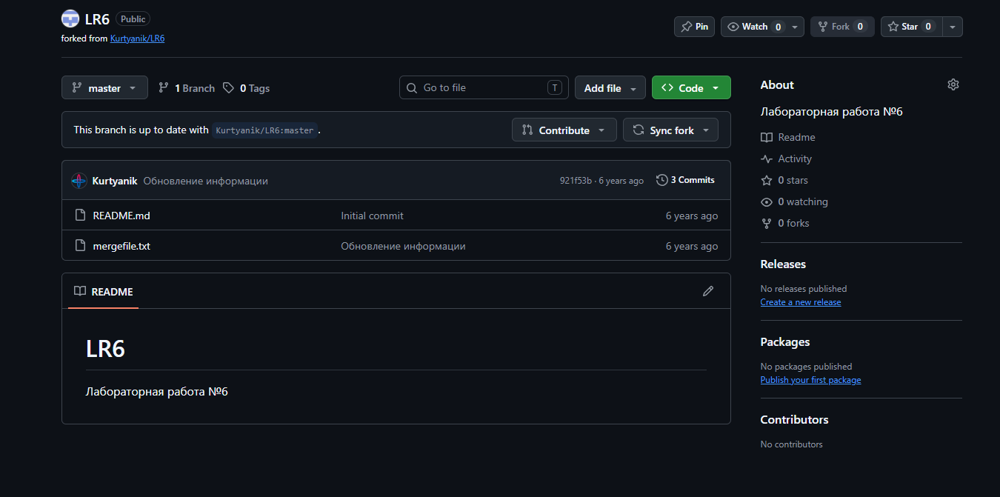

### 2. Установка и настройка Git
Git установлен, указаны имя пользователя и email.

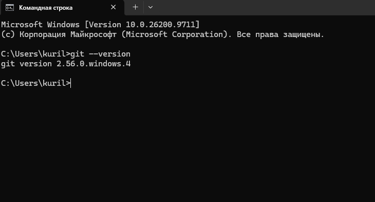
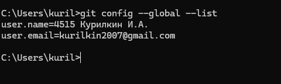

### 3. Клонирование репозитория
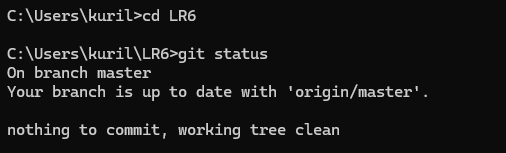

### 4. Добавление файла через GitHub и git pull
Файл `from_github.txt` создан через интерфейс GitHub и подтянут в локальный репозиторий.

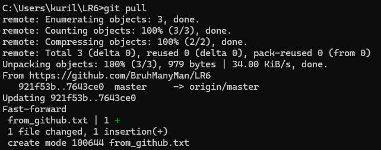

### 5. История веток и последние изменения
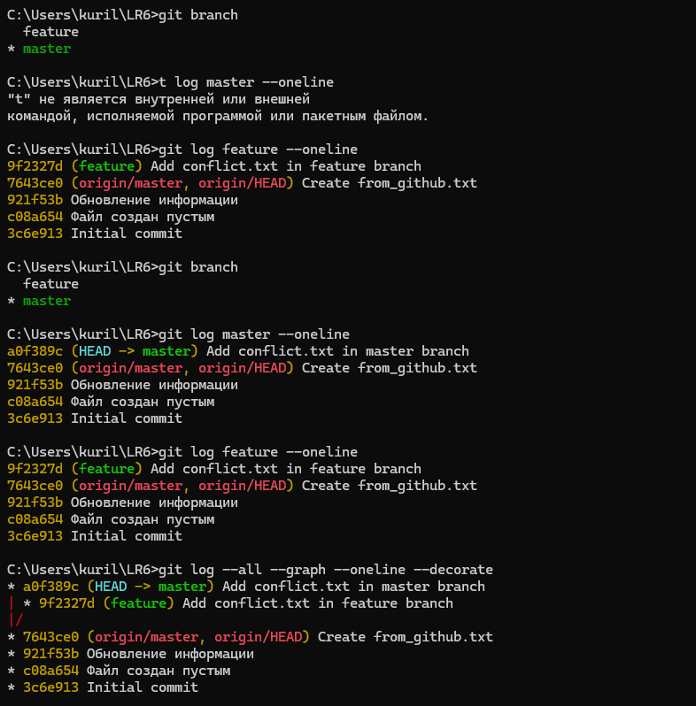
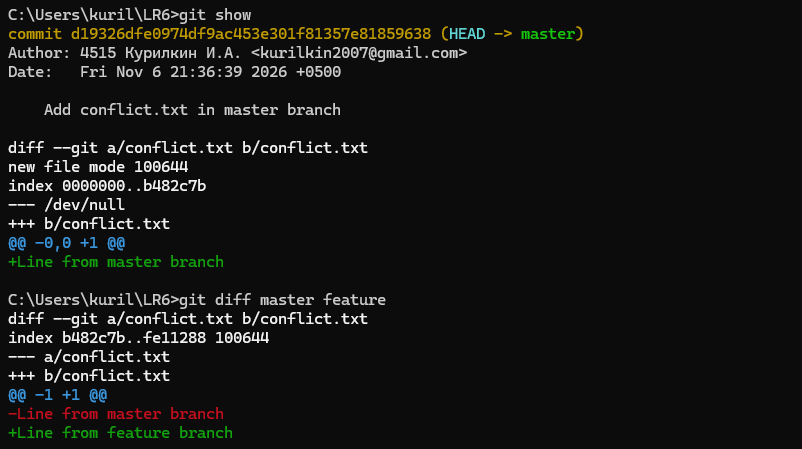

### 6. Слияние в master и разрешение конфликта
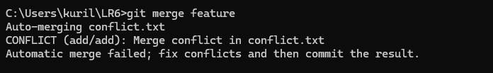
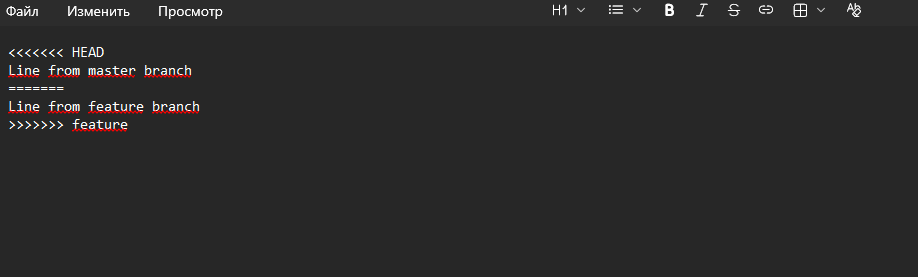
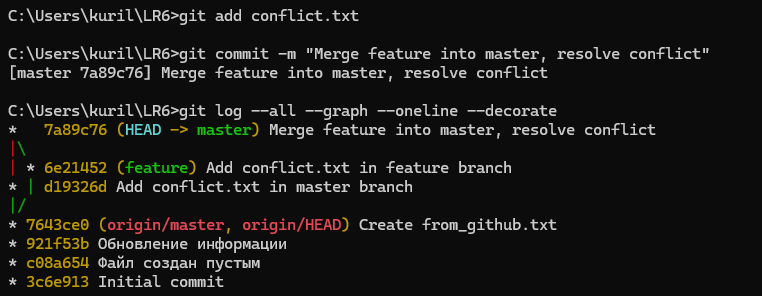

### 7. Удаление побочной ветки
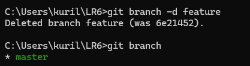

### 8. Коммиты с комментариями
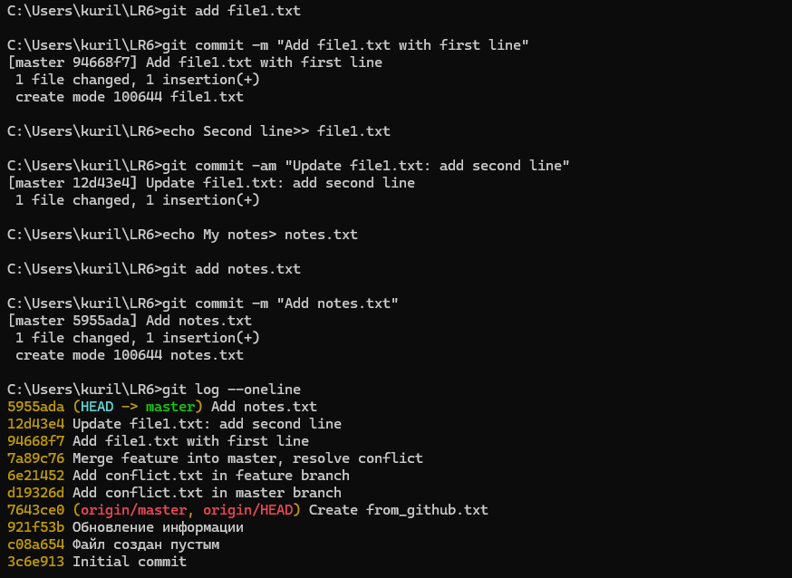

### 9. Откат коммита
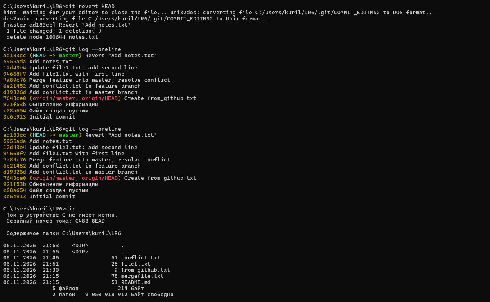

### 10. Ветка для отчёта
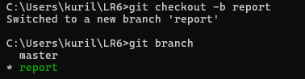

## Лог команд

```bash
git --version
git config --global user.name "4515 Курилкин И.А."
git config --global user.email "ваш_email"
git clone https://github.com/BruhManyMan/LR6.git
cd LR6
git status
git pull
git log --oneline
git checkout -b feature
git add conflict.txt
git commit -m "Add conflict.txt in feature branch"
git checkout master
git add conflict.txt
git commit -m "Add conflict.txt in master branch"
git log master --oneline
git log feature --oneline
git log --all --graph --oneline --decorate
git show
git diff master feature
git merge feature
git add conflict.txt
git commit -m "Merge feature into master, resolve conflict"
git branch -d feature
git add file1.txt
git commit -m "Add file1.txt with first line"
git commit -am "Update file1.txt: add second line"
git add notes.txt
git commit -m "Add notes.txt"
git revert HEAD
git checkout -b report
```

## История операций

d700e6a | 2026-11-06 | 4515 Курилкин И.А. | Update project
5decfb1 | 2026-11-06 | 4515 Курилкин И.А. | Update project
57eaa74 | 2026-11-06 | 4515 Курилкин И.А. | Update project
51dc7ed | 2026-11-06 | 4515 Курилкин И.А. | Update project
2ba6af3 | 2026-11-06 | 4515 Курилкин И.А. | Add report files
f4ac504 | 2026-11-06 | 4515 Курилкин И.А. | Report: add steps 1-4 with screenshots
ad183cc | 2026-11-06 | 4515 Курилкин И.А. | Revert "Add notes.txt"
5955ada | 2026-11-06 | 4515 Курилкин И.А. | Add notes.txt
12d43e4 | 2026-11-06 | 4515 Курилкин И.А. | Update file1.txt: add second line
94668f7 | 2026-11-06 | 4515 Курилкин И.А. | Add file1.txt with first line
7a89c76 | 2026-11-06 | 4515 Курилкин И.А. | Merge feature into master, resolve conflict
6e21452 | 2026-11-06 | 4515 Курилкин И.А. | Add conflict.txt in feature branch
d19326d | 2026-11-06 | 4515 Курилкин И.А. | Add conflict.txt in master branch
7643ce0 | 2026-11-06 | BruhManyMan | Create from_github.txt
921f53b | 2020-11-21 | Kurtyanik | Обновление информации
c08a654 | 2020-11-21 | Kurtyanik | Файл создан пустым
3c6e913 | 2020-11-21 | Kurtyanik | Initial commit
